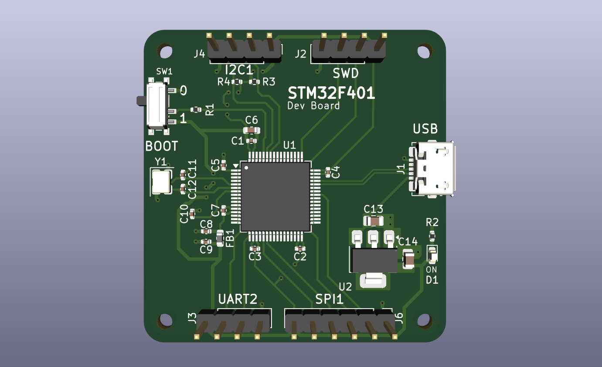
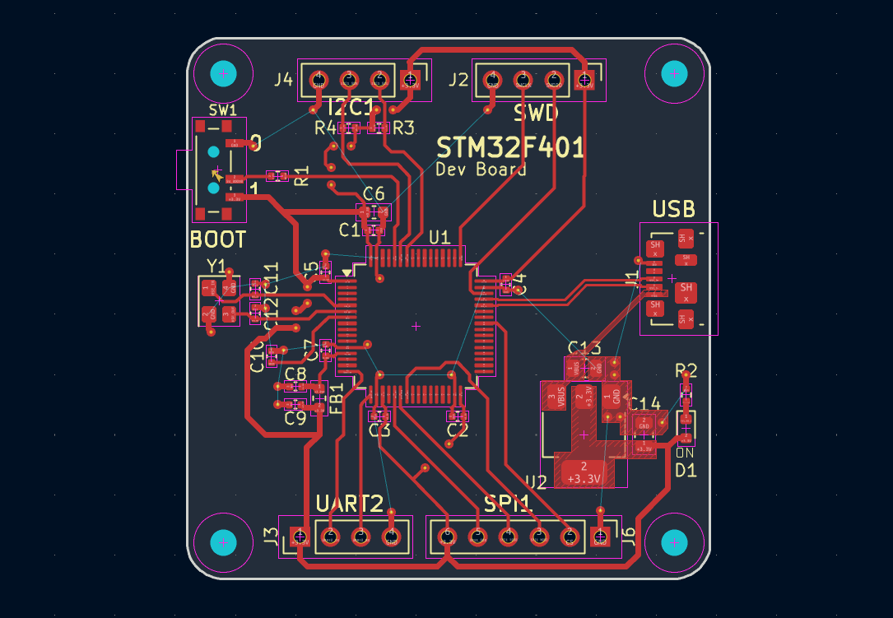
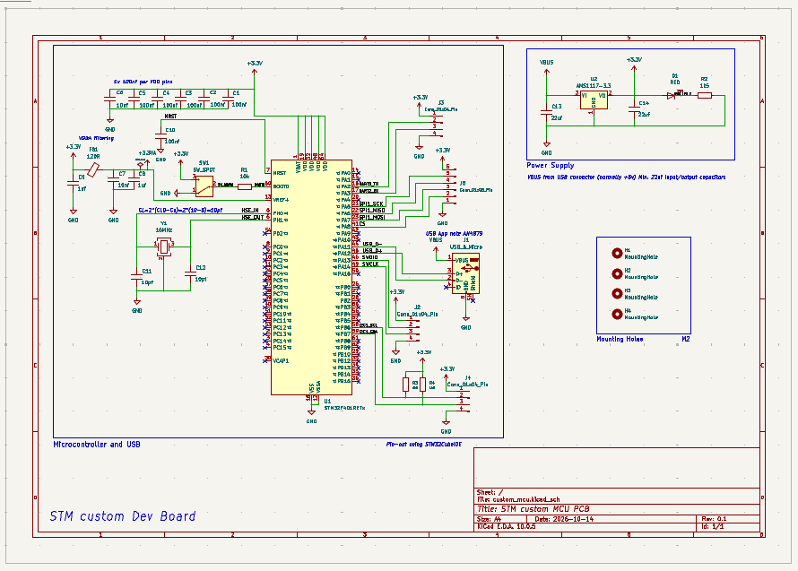

# STM32 Custom Development Board

A custom STM32F401 development board designed in KiCad, featuring USB connectivity, SWD debugging, and dedicated peripheral headers.

## 3D PCB View



## PCB Layout



## Schematic



## Features

- **Microcontroller:** STM32F401
- **USB Connectivity:** USB connector for power
- **Debugging:** SWD header for programming and debugging
- **Boot Configuration:** BOOT selection switch
- **Communication Interfaces:** UART2, SPI1, and I2C1 headers
- **Power Supply:** USB VBUS to 3.3V regulation
- **PCB Design:** Two-layer PCB designed using KiCad


## Tools Used

- KiCad 10

## Repository Contents

- KiCad schematic and project files
- PCB layout
- Design preview images
---

Designed by ```Amiruddin```